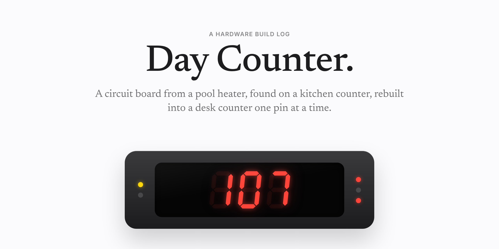
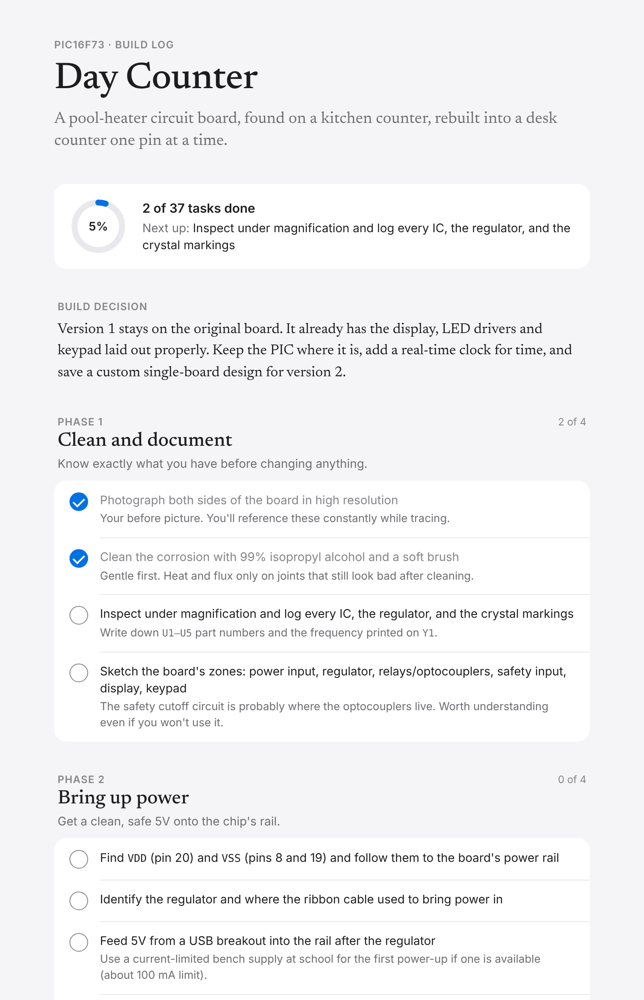

<p align="center">
  <picture>
    <source media="(prefers-color-scheme: dark)" srcset="assets/readme/hero-dark.png">
    
  </picture>
</p>

<p align="center">
  <a href="#the-story">The story</a> &nbsp;·&nbsp;
  <a href="#the-hardware">The hardware</a> &nbsp;·&nbsp;
  <a href="#roadmap">Roadmap</a> &nbsp;·&nbsp;
  <a href="#the-companion-app">The app</a>
</p>

<br>

## The story

One day there was a circuit board sitting on my kitchen counter. It came out of our pool heater: a Hayward controller built by Emerson Climate Technologies, with its most important parts sealed against water.

At its center is a Microchip PIC16F73, a small 8-bit microcontroller. Next to it sits a three-digit seven-segment display, the kind that once showed water temperature.

I had just finished Charles Petzold's *Code*, and this felt like the right next step. The plan is to trace every pin, write my own firmware, and turn that display into a counter for the days since something that matters.

This repository is the build log. Everything gets documented as it happens, mistakes included.

<br>

## The hardware

| | |
|:--|:--|
| **Board** | Hayward pool heater controller, made by Emerson Climate Technologies |
| **Microcontroller** | Microchip PIC16F73, 28-pin SOIC |
| **Program memory** | 4K words of flash (about 7 KB) |
| **RAM** | 192 bytes |
| **Operating voltage** | 4.0 – 5.5 V |
| **Date code** | 2034, week 34 of 2020 |
| **Display** | Three-digit seven-segment, plus five status LEDs |
| **Toolchain** | MPLAB X IDE, XC8 compiler, PICkit programmer |

One constraint shapes the whole design: the PIC16F73 has no data EEPROM, so it forgets everything when the power drops. Version 1 adds a battery-backed DS3231 real-time clock over I²C to keep the count.

<br>

## Roadmap

- [ ] **Clean and document.** Photograph the board, clean the corrosion, log every part.
- [ ] **Bring up power.** Get a clean 5 V onto the chip's rail.
- [ ] **Map the board.** Trace every display segment, LED and header back to a PIC pin.
- [ ] **Set up the toolchain.** MPLAB X, XC8 and a PICkit.
- [ ] **First contact.** Read the factory firmware, then blink one LED in assembly.
- [ ] **Drive the display.** One segment, one digit, then all three multiplexed.
- [ ] **Keep time and remember it.** Timer1, then the real-time clock.
- [ ] **Enclosure.** Measure, model and 3D print a case for the desk.
- [ ] **Version 2.** A custom single-board design with a fresh chip.

<br>

## The companion app

<p align="center">
  <picture>
    <source media="(prefers-color-scheme: dark)" srcset="assets/readme/app-dark.png">
    
  </picture>
</p>

A small Mac app that tracks every task in the roadmap. It opens like any other app, follows your Mac's light or dark mode, and saves progress locally as you check things off.

**Run it from source**

```bash
python3 -m venv .venv
source .venv/bin/activate
pip install -r requirements.txt
python app.py
```

**Build the app**

```bash
./build.sh
```

This packages `Day Counter Plan.app` with PyInstaller and installs it in `/Applications`.

**Change the icon**

```bash
./make_icon.sh path/to/icon-1024.png
./build.sh
```

<br>

## Repository

| Path | What it is |
|:--|:--|
| `app.py` | The app: opens the window and saves progress |
| `ui/index.html` | The interface |
| `ui/tasks.json` | The build plan. Edit this to add or change tasks |
| `assets/` | App icon and README images |
| `firmware/` | XC8 firmware for the PIC16F73. Coming soon |

Progress is stored at `~/Library/Application Support/DayCounterPlan/progress.json`, outside the repository.

<br>

## Acknowledgments

- Charles Petzold, *Code: The Hidden Language of Computer Hardware and Software*
- The teachers who helped me read my first datasheet

<br>

## License

[MIT](LICENSE)